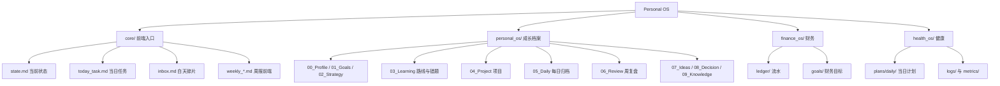
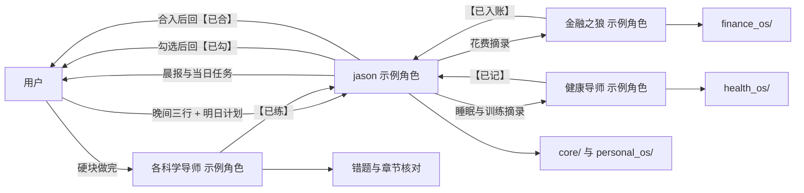

# Personal OS Template

一个由多个 AI bot 分工维护的个人成长操作系统模板。

你不必每天打开仓库填表。晚上用两三分钟口述，早上读一份晨报；学习、作息和花费由不同角色写入各自的目录。规则只放在一份 [`AGENTS.md`](AGENTS.md) 里，当前状态放在一份 `core/state.md` 里。本仓库是从零整理的通用骨架和模板，不含任何真实个人档案。

## 这是什么

这是一套用 Markdown 文件组成的个人操作系统：把「今天要做什么、学到哪了、睡得如何、花了多少钱」从聊天窗口里搬进可版本管理的文件，并让多个 AI 角色按权限维护。

典型分工（均为示例角色，可改名）：

- **jason**：秘书与督导。收晚间口述，写晨报、当日任务、状态和归档。
- **金融之狼**：只记账本与消费建议。
- **健康导师**：只写作成息、训练和饮食。
- **各科学导师**：布置和核对当天的学习硬块。

人负责口述事实和做硬块；bot 负责记录、提醒、对账和复盘。谁都可以读规则，但每个目录通常只有一个角色写。

本模板可用普通文本编辑器维护，也可以把整个文件夹当作 [Obsidian](https://obsidian.md/) 仓库打开。模板不附带任何个人的 Obsidian 工作区或插件配置。

## 为什么做

个人成长相关的约定，很容易碎在聊天记录、备忘录和好几个「说明文件」里。用了几天之后，常见的问题是：

- **规则不只一份。** 这边改了作息，那边的旧说明还在生效，bot 各执行各的。
- **当前状态只活在对话里。** 换一天、换一个窗口，就要把进度、欠账和复习安排重新讲一遍。
- **学习和生活对不上。** 课有没有真正做完、几点上床、花了多少钱，如果只靠印象补全，记录会看起来很完整，却经不起第二天核对。
- **纠正没有写回文件。** 聊天里改过的规矩，若没有当天写进唯一的规则文件，明天又会按旧办法走。

这套模板想解决的，就是把规则、状态和每日证据放到固定的位置，让多个 bot 能接力，而不靠「记得上次怎么说的」。

## 架构图

### 目录结构

`00_Profile`、`01_Goals`、`02_Strategy` 以及真实账本、健康档案建议留在私有仓库或本机，不要随模板公开。

### 角色与数据流

没有对应口令，就不勾选、不入账、不把「没报」写成「已完成」。

## 每天怎么运转

1. **晚间口述。** 用户交给 jason 三行：硬块做了没有、各大约多久；花费的金额和用途（没有就写无）；一句心情或卡点。再加上明天打算做哪几块。不必打开仓库填表。
2. **晨间归档与晨报。** jason 清空 inbox，把昨天归档到 `personal_os/05_Daily/`，更新 `core/state.md`，按昨晚的计划生成当天的 `today_task.md`，再发出晨报。用户没给计划，就写「计划未给」，不自行补排。
3. **白天硬块与导师核对。** 学习硬块找对应导师；导师回【已练】之后，jason 才勾选并回【已勾】。花费转给金融之狼，睡眠和训练转给健康导师。白天的碎片可以丢进 inbox，第二天再归档。
4. **周日复盘（示例：约 21:00）。** 对照一周的归档写趋势，不堆流水。可把当周账单对账并进这次复盘。下周三个重点先写入，再请用户确认。

复习到期时，晨报会列出该章总结路径，以及最多 3 道「待重做」错题，并提醒一句固定方法：先闭卷回忆，再做 1–2 道题或重做错题，最后对照章节总结查漏。

## 怎么用

1. 复制本模板到你自己的仓库（建议先保持私有）。不要把他人的真实档案拷进来。
2. 通读并修改根目录 [`AGENTS.md`](AGENTS.md)：把所有「示例：」项改成你的作息、课程、训练日、时区和提醒时间；角色名可保留也可自定。
3. 把 `core/state.template.md` 复制为 `core/state.md`，按你的课程填写复习排期，不要照抄 `examples/` 里的虚构数据。
4. 按需复制财务与健康模板（如 `finance_os/ledger/_template.md`、`health_os/plans/daily/_template.md`）为实际文件。真实金额、身体数据和个人信息不要放进公开仓库。
5. `personal_os/00_Profile/`、`01_Goals/`、`02_Strategy/` 只放你自己的说明，并且留在私有处。模板里这三处只有用途说明，没有虚构人物小传。
6. 若使用远程变更请求（Path B），指定谁负责审阅和合入低风险日志；结项、改目标和改规则必须先问你。
7. 看一眼 [`examples/2026-11-21/`](examples/2026-11-21/) 可了解一天的文件长什么样。那些内容全部是虚构示例，不能当作使用记录。

## 经验与踩坑

- **规则只能有一份。** 子目录的 `AGENTS.md` 只说明「这个文件夹放什么」，不另写一套作息或课程规矩。聊天里改了约定，当天写回根目录 `AGENTS.md`，并在变更记录加一行。只在对话里答应，等于没改。
- **用 `state.md` 保存当前状态。** 进度、复习排期、开放债和作息以这份文件为准，而不是以某次聊天的记忆为准。晨间先读它，再生成当天任务。
- **聊天里的纠正必须写回文件。** 包括「这门课不要自己往下赶」「没报金额就写未报」「回顾方法改成这样」。不写回文件，下一个窗口还会按旧规则执行。
- **不编造、不代勾。** 没报的睡眠、花费、分钟数留空或写「未报」。没有【已练】【已入账】【已记】这些回执，就不把事项勾成完成。
- **开放债要短。** 最多三条，每条一行当前状态，不要把多日历史粘进新的任务页。

## 许可

本模板以 [MIT License](LICENSE) 发布。Copyright © 2026 the template authors。
