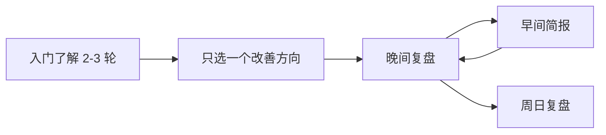
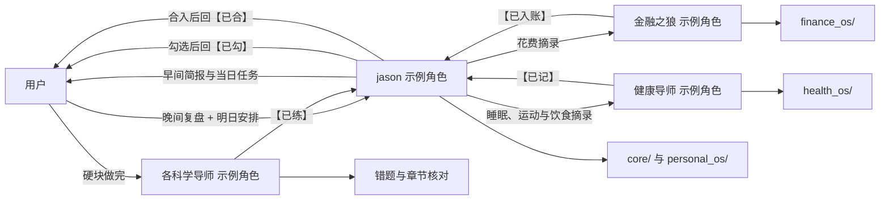

# Student AI OS

一个面向学生、由多个 AI bot 分工维护的整体生活改进框架。

你不必每天打开仓库填表。先对你有基本了解，再让你只选一个改善方向；之后晚上用两三分钟口述复盘，早上读一份简报。学习、健康和花费由不同角色写入各自的目录。规则只放在一份 [`AGENTS.md`](AGENTS.md) 里，当前状态放在一份 `core/state.md` 里。上手说明见 [`personal_os/新手指引.md`](personal_os/新手指引.md)。本仓库是从零整理的通用骨架和模板，不含任何真实个人档案。

## 这是什么
这实际上是我作为学生的日常生活的提效工具，我称作他为我们学生的ai操作系统。

何为学生ai操作系统，核心就是，通过让我们每个人每天的生活数据化，ai化，智能化。进而进一步提高我们的成绩，让我们每一天更有规划，更有效率。

总之就是改变我们的生活，无论是成绩，健康，经济，外貌（还没加入）。

## 为什么做

我之所以做这个，是因为，我观察大部分大学生的一天就是，早上不定时起来，有课就迫不得已起床，没课就赖在床上随性起来，然后上着学校无聊的课程，在课程上大多游玩手机度过这煎熬的时间。生活中大部分的时间都是零碎的。这样一天下来每天的感觉就是今天一无所获，一个学期度过下来感觉就是，下学期我一定要好好学习😀。

当然大学是人生的假期这句话我不反对，因为也许真的很难有像大学这样自由的时间了，既没有太大经济压力，也没有别的过多的烦恼，每天最大的困惑或许就是中午吃啥了。

所以这个项目也就只是对于那些对于当前生活不满意的，自己渴望提升的（怎么听起来有点像鸡汤）。总之就是不满足于我开始说的那些现状的，觉得自己每天很迷茫，想要学习却无法控制自己的。

## 使用流程
这里目前我用的还是grokbot，之所以用它的核心原因就是可以连接cursor的云端服务，实现24小时在线。

你可以创建一个新的bot，然后直接把仓库地址发送给他，让他把这个应用到你的grokbot中。

导入后，对应的 Grok Bot会先用几句话介绍每天怎么用，然后开始了解你。完整说明见 [`personal_os/新手指引.md`](personal_os/新手指引.md)。

1. **了解。** 分两三轮问：年龄；身高体重（选填）；每天学习大概时长、效率、对自己学习的满意程度（不问排名）；睡眠是否规律、是否熬夜、自我感觉如何；有没有规律运动；饮食是否注重健康；每月可支配大概情况（选填）。不愿报的选填项写「未报」，不追问。不主动问地区、学校名或排名。
2. **选一个方向。** 在学习、睡眠与作息、运动、饮食、花费里选一条先改。只有这条进入日常监督，其他模块只做轻量记录。小心贪多嚼不烂，因为发现
3. **日 / 周循环。** 晚上复盘，早上读简报，周日看一周趋势。第一周建议只跑晚间复盘加一块硬块，例行提醒按需再开。

## 架构图

### 目录结构

`00_Profile`、`01_Goals`、`02_Strategy` 以及真实账本、健康档案建议留在私有仓库或本机，不要随模板公开。活档案仓库建议保持私有。

### 角色与数据流

没有对应口令，就不勾选、不入账、不把「没报」写成「已完成」。健康摘录默认是轻量记录；只有你把睡眠（或运动、饮食）选为当前主线后，才进入日常监督。

## 每天怎么运转

1. **晚间复盘。** 交给 jason：今日硬块完成情况、花费、心情与心得、明天安排。不必打开仓库填表。
2. **早间简报。** jason 清空 inbox，把昨天归档到 `personal_os/05_Daily/`，更新 `core/state.md`，按昨晚的计划生成当天的 `today_task.md`，再发出晨报。用户没给计划，就写「计划未给」，不自行补排，也不替你排日程。
3. **白天硬块与导师核对。** 学习硬块找对应导师；导师回【已练】之后，jason 才勾选并回【已勾】。花费转给金融之狼；睡眠、运动和饮食转给健康导师。白天的碎片可以丢进 inbox，第二天再归档。
4. **周日复盘。** 时间由你自定。对照一周的归档写趋势，不堆流水。可把当周账单对账并进这次复盘。下周重点先写入，再请你确认。

复习到期时，晨报会列出该章总结路径，以及最多 3 道「待重做」错题，并提醒一句固定方法：先闭卷回忆，再做 1–2 道题或重做错题，最后对照章节总结查漏。学习流程（当晚自定硬块、导师【已练】才勾、错题三档、复习间隔 1→3→7→14→30 天、章节总结）都可以直接用；课程名由你自己填。

## 怎么用

1. 复制本模板到你自己的仓库（建议先保持私有）。不要把他人的真实档案拷进来。先读 [`personal_os/新手指引.md`](personal_os/新手指引.md)。
2. 通读并修改根目录 [`AGENTS.md`](AGENTS.md)：把「示例：」项改成你的课程、时区和角色分工；提醒时间、作息红线由你自定，不要沿用任何现成钟点。角色名可保留也可自定。
3. 把 `core/state.template.md` 复制为 `core/state.md`。入门了解完成后再填写当前主线和课程，不要照抄 `examples/` 里的虚构数据。需要时，可复制 `personal_os/00_Profile/入门档案.template.md` 为实际档案。
4. 按需复制财务与健康模板（如 `finance_os/ledger/_template.md`、`health_os/plans/daily/_template.md`）为实际文件。真实金额、身体数据和个人信息不要放进公开仓库。
5. `personal_os/00_Profile/`、`01_Goals/`、`02_Strategy/` 只放你自己的说明，并且留在私有处。模板里这三处没有虚构人物小传。
6. 若使用远程变更请求（Path B），指定谁负责审阅和合入低风险日志；结项、改目标、改规则和更换当前主线必须先问你。
7. 看一眼 [`examples/2026-11-21/`](examples/2026-11-21/) 可了解一天的文件长什么样。那些内容全部是虚构示例，不能当作使用记录。

## 经验与踩坑

- **规则只能有一份。** 子目录的 `AGENTS.md` 只说明「这个文件夹放什么」，不另写一套习惯或课程规矩。聊天里改了约定，当天写回根目录 `AGENTS.md`，并在变更记录加一行。只在对话里答应，等于没改。
- **一次只抓一个主体。** 选定一条主线后，只有这条进入日常监督；其他模块只记一笔，不要一上来全开提醒。
- **用 `state.md` 保存当前状态。** 当前主线、进度、复习排期和开放债以这份文件为准，而不是以某次聊天的记忆为准。晨间先读它，再生成当天任务。
- **聊天里的纠正必须写回文件。** 包括「这门课不要自己往下赶」「没报金额就写未报」「回顾方法改成这样」。不写回文件，下一个窗口还会按旧规则执行。
- **不编造、不代勾。** 没报的睡眠、花费、分钟数留空或写「未报」。没有【已练】【已入账】【已记】这些回执，就不把事项勾成完成。
- **开放债要短。** 最多三条，每条一行当前状态，不要把多日历史粘进新的任务页，也不要默认塞入未选中方向的监督项。

## 许可

本模板以 [MIT License](LICENSE) 发布。Copyright © 2026 the template authors。
